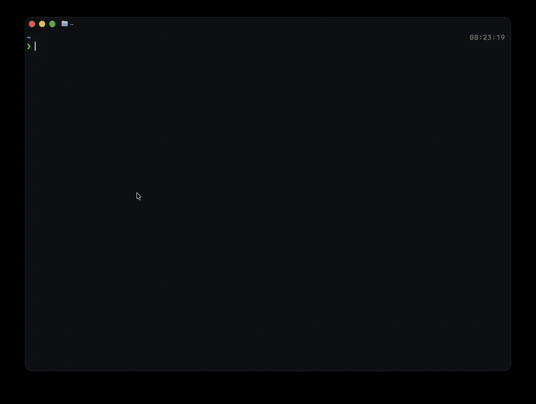

# jenkui

A terminal UI for Jenkins. Browse views, jobs, and builds; watch a build's console
output and stage timeline live; trigger a build (including parameterized jobs),
abort a running one, and manage the build queue.



Needs [Bun](https://bun.sh) 1.4.0 or later on your PATH. The package runs its
bundled JavaScript through Bun, so Bun is also its runtime.

## Install

```bash
npm install -g jenkui
# or
bun install -g jenkui
```

Then run it:

```bash
jenkui
```

Useful flags:

```bash
jenkui --help              # usage and keys
jenkui --version           # print the version
jenkui --profile prod      # start on a specific profile
jenkui --profile list      # list configured profiles
```

On first run there is no config, so the header shows a credentials error. Create
the config file next.

### Point it at Jenkins

Make a config directory and copy the example:

```bash
mkdir -p ~/.config/jenkui
cp "$(npm root -g)/jenkui/config.example.json" ~/.config/jenkui/config.json
```

Or write `~/.config/jenkui/config.json` yourself. One profile is enough to start:

```json
{
  "profiles": {
    "default": {
      "url": "https://jenkins.example.com",
      "user": "your_user",
      "token": "your_api_token"
    }
  }
}
```

Add more profiles when you have a second server. `defaultProfile` picks which one
loads first, and `p` switches at runtime:

```json
{
  "defaultProfile": "dev",
  "profiles": {
    "dev":  { "url": "https://jenkins-dev.example.com", "user": "your_user", "token": "your_api_token" },
    "prod": { "url": "https://jenkins-prod.example.com:8080", "user": "your_user", "token": "your_api_token" }
  },
  "pollIntervalMs": 2000,
  "autoRefreshMs": 5000,
  "pageSize": 100
}
```

| Option | Meaning |
| --- | --- |
| `pollIntervalMs` | How often the console and stage view update while a build runs |
| `autoRefreshMs` | How often the list and queue refresh in the background |
| `pageSize` | Builds fetched per page; more load as you scroll |

Get an API token from Jenkins under **User → Configure → API Token**.

If the server uses a self-signed certificate, set `"insecure": true` on that
profile. This disables certificate verification for that profile only:

```json
{ "url": "https://jenkins.internal", "user": "you", "token": "…", "insecure": true }
```

`pollIntervalMs`, `autoRefreshMs`, and `pageSize` are clamped to safe ranges
(250 ms, 1 s, and 1–500 respectively) so a bad config cannot hammer Jenkins.

If you leave out `profiles`, a single top-level `"jenkins"` object still works as
one profile. `JENKINS_URL`, `JENKINS_USER`, and `JENKINS_TOKEN` override the file
when set. Triggering and aborting builds needs an account that can build the jobs.

### Colors

Pick a named theme in `~/.config/jenkui/theme.json`:

```json
{ "theme": "tokyonight", "mode": "system" }
```

- `theme`: a preset name, or `system` to use the terminal's own ANSI colors.
- `mode`: `dark`, `light`, or `system` (default). `system` follows the terminal's
  light/dark report, so the palette switches when your terminal does.
- `colors`: optional per-token overrides applied on top of the preset.

Every preset ships a dark and a light palette. Themes included: `default`,
`tokyonight`, `catppuccin`, `dracula`, `gruvbox`, `nord`, `one-dark`, `rosepine`.
See `theme.example.json`. With no `theme.json` at all, jenkui starts on `system`.

```json
{ "theme": "tokyonight", "mode": "dark", "colors": { "accent": "#FF00FF" } }
```

Use `theme: "system"` to inherit the terminal palette, so jenkui matches whatever
scheme you already run:

```json
{ "theme": "system" }
```

Each profile can carry its own badge color for the header. jenkui picks the text
color from the badge background so it stays readable:

```json
{
  "theme": "tokyonight",
  "profile": { "dev": "#2E7D32", "prod": "#B71C1C" }
}
```

The config and theme load once at startup. Restart jenkui after editing them.

## Keys

| Key | Action |
| --- | --- |
| `j` `k` `↓` `↑` | move the selection |
| `h` `←` | go back one level |
| `l` `→` | open the selected item |
| `enter` | open the selected item |
| `/` | search (fuzzy, per level, kept when you return); in the stage view it highlights log lines |
| `esc` | back, leave search, or close a dialog |
| `f` | cycle the status filter: all, failed, running, success (list views) |
| `b` | start a new build; parameterized jobs open an edit form first |
| `x` | abort the running build, or cancel the queued item in the queue dialog |
| `o` | open the console or job in your browser |
| `y` | copy the build or job link |
| `.` | view the build queue; `enter` opens the build, `x` cancels it |
| `p` | switch Jenkins profile |
| `A` | toggle auto-refresh |
| `r` | refresh now |
| `?` | show all shortcuts |
| `` ` `` | toggle the debug console overlay |
| `q` | quit |

## How it maps to Jenkins

Jenkins **views** become organizations (`POLARIS`, `ALCOR`, …). Each job in a view
is a project; folders, multibranch projects, and organization folders are expanded
recursively, and the folder path shows on the row. Jobs that no view lists go under
`other`. FreeStyle, pipeline, and matrix jobs all show up.

The console streams through Jenkins' `progressiveText` endpoint. ANSI colors from
pipeline tools are mapped to the active theme instead of being stripped, stage
durations and status refresh while a build runs, and Jenkins' masked-credential
markers (`ha:////…`) are filtered out of the output. Pressing `b` also follows the
queue to the new build number, so the stage view can open as soon as it starts.

The view tree is cached under `~/.cache/jenkui` (or `$XDG_CACHE_HOME/jenkui`), so
startup paints the previous list while a fresh fetch runs. Delete the directory to
force a clean start. The cache never contains credentials.

## Development

```bash
bun install
bun dev          # watch mode
bun start        # run once
bun run build    # bundle to dist/ (this is what npm ships)
bun test         # unit + fake-Jenkins tests
bun run lint     # Bun's built-in linter
bun run typecheck
bun run check    # typecheck + lint + tests
```

Bun's linter ships in 1.4.4, which is still canary as of this writing. If
`bun run lint` says it needs 1.4.4, upgrade with `bun upgrade --canary` (or wait
for 1.4.4 stable). The app itself still runs on Bun 1.4.0+.

`src/` layout:

```
index.tsx            bootstrap: CLI parsing, renderer, React root, debug console
cli.ts               argument parsing (help, version, profile)
app.tsx              wiring, actions, keyboard dispatch, layout
state/               AppState + reducer, keymap, per-view meta
config/              reads ~/.config/jenkui/{config,theme}.json, themes
api/jenkins.ts       per-profile Jenkins client (read, trigger, stop, queue)
hooks/               organizations, deployments, run stream, queue, selection
components/          header, search bar, list, dialogs
screens/             org, project, deploy, run (stage view)
utils/               ansi log parser, format, search, stages, cache, host, contrast
types.ts             domain types
```

## CI

`.github/workflows/ci.yml` runs typecheck, lint, tests, and a bundle smoke build
on every push to `main` and every pull request.

`.github/workflows/release.yml` publishes to npm when you push a `v*` tag. It
needs an `NPM_TOKEN` repository secret with publish access, and uses npm
provenance (OIDC) so the release links back to the workflow run.

```bash
git tag v0.1.1 && git push origin v0.1.1
```

## Troubleshooting

**`error: Missing Jenkins credentials`**: the config file is missing or the
`user`/`token` fields are empty. Check `~/.config/jenkui/config.json`.

**`Jenkins 401`**: wrong user or token. Generate a fresh token under
**User → Configure → API Token**.

**`Jenkins 403`**: the account can read jobs but not build them. Triggering and
aborting need the build permission for those jobs.

**Self-signed certificate errors**: add `"insecure": true` to that profile.
Prefer installing the CA in your trust store when you can.

**Wrong or stale job list**: the tree comes from the disk cache first and then
Jenkins. Delete `~/.cache/jenkui` and press `r` to force a fresh read.

**Config changes do nothing**: the file is read at startup. Restart jenkui.

**Nothing renders**: make sure the terminal is a real TTY and Bun 1.4.0+ is on
your PATH (`bun --version`).
